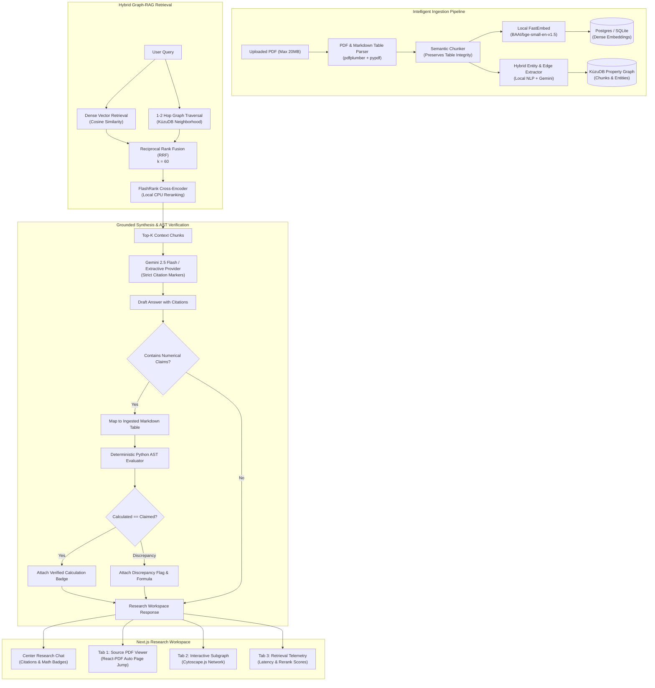

# 🚀 DocuQuery Engine
### *Self-Corrective, Hybrid Graph-RAG Document Intelligence Platform*

[](https://fastapi.tiangolo.com)
[](https://nextjs.org)
[](https://kuzudb.com)
[](https://github.com/qdrant/fastembed)
[](https://github.com/PrithivirajDamodaran/FlashRank)
[]()

> **Portfolio Context:** Built as an elite Applied AI Engineering platform for a 3rd-year Computer Science Engineering student. Demonstrates genuine Applied AI architecture rather than a thin wrapper over an LLM API: dense vector retrieval, in-process property graph traversal, local cross-encoder reranking, and deterministic numerical verification via an Abstract Syntax Tree (AST) checker.

---

## 🏛️ System Architecture

DocuQuery Engine is engineered as a high-performance **Modular Monolith** designed for zero-latency local execution, robust data lineage, and zero recurring embedding costs.



---

## ⚡ Core Technical Features

### 1. In-Process Graph Database (KùzuDB)
* Embedded directly within the Python process—no complex Neo4j or Memgraph server clusters to manage.
* Implements a property graph schema linking `ChunkNode` to `Entity` via `MENTIONS`, and `Entity` to `Entity` via `RELATES_TO`.
* Provides sub-15ms multi-hop neighborhood extraction and cascading deletion when documents are deleted.

### 2. Zero-Cost Local Embeddings & Reranking (100% on CPU)
* **Embedding Model:** `BAAI/bge-small-en-v1.5` running locally via ONNX Runtime with FastEmbed. Produces 384-dimensional dense vectors with zero API expenditure.
* **Reranker:** `FlashRank` (`ms-marco-TinyBERT-L-2-v2`) cross-encoder executing in ~25-40ms on CPU, suppressing irrelevant passages before LLM synthesis.

### 3. Deterministic AST Numerical Verifier
* Rather than trusting LLM hallucinated calculations for financial or technical claims, DocuQuery extracts numerical claims (e.g., *"revenue grew by 15.0%"* or *"operating margin of 25.0%"*).
* Maps the claim to raw Markdown tables preserved during semantic ingestion.
* Evaluates the arithmetic deterministically in Python using safe Abstract Syntax Tree (AST) node parsing (strictly disallowing unsafe constructs).
* Attaches an interactive **"Verified Calculation"** badge in the UI displaying the formula, computed value, and source table snippet.

### 4. Reciprocal Rank Fusion (RRF)
Combines the top dense vector matches and graph connectivity:
$$\text{RRF\_Score}(d) = \sum_{m \in \{\text{vector}, \text{graph}\}} \frac{1}{k + \text{rank}_m(d)} \quad (k=60)$$

### 5. Quantitative RAG Evaluation System
Includes an automated benchmark test suite running 15 gold-standard question-answer-context pairs across technical and financial queries.
Measures:
* **Context Precision:** Fraction of retrieved chunks containing expected ground truth concepts.
* **Faithfulness:** Proportion of statements in generated answers directly grounded in the context.
* **Answer Relevance:** Semantic cosine similarity between the query and synthesized answer.
* **Math Verification Accuracy:** Precision of deterministic arithmetic checks against source tables.

---

## 🛠️ Technology Stack

| Layer | Technologies |
| :--- | :--- |
| **Frontend** | Next.js 14 (App Router), TypeScript, Tailwind CSS, Lucide Icons |
| **Visualizations** | Cytoscape.js (Interactive Graph Canvas), React-PDF viewer |
| **Backend** | Python 3.11 - 3.13, FastAPI, Pydantic v2, SQLAlchemy |
| **Databases** | PostgreSQL with `pgvector` (via Docker) + SQLite local zero-config fallback |
| **Graph DB** | KùzuDB 0.11+ (In-process embedded property graph) |
| **AI Models** | FastEmbed (`bge-small-en-v1.5`), FlashRank (`TinyBERT-L-2-v2`), Gemini 2.5 Flash |

---

## 💻 Windows 11 Step-by-Step Setup Guide

### Prerequisites
1. **Python 3.11 - 3.13** installed and added to `PATH`.
2. **Node.js (v18+)** and **npm** installed.
3. *(Optional)* **Docker Desktop** if you wish to run PostgreSQL with `pgvector` container.

### Step 1: Clone or Navigate to Project
```powershell
cd "c:\Users\prade\OneDrive\Desktop\DocuQuery Engine"
```

### Step 2: Configure Environment Variables
Copy `.env.example` to `.env`:
```powershell
Copy-Item .env.example .env
```
*(Optional)* Add your Gemini API key in `.env` if you wish to use live Google Gemini generation:
```env
GEMINI_API_KEY=your_gemini_api_key_here
```
> **Note:** If no API key is provided, DocuQuery Engine operates seamlessly in **Offline Grounded Mode**, providing extractive synthesis with citations and full local AST verification!

### Step 3: Set up Backend Virtual Environment
```powershell
# Create virtual environment (if not already created)
python -m venv venv

# Activate virtual environment
.\venv\Scripts\Activate.ps1

# Install backend dependencies
pip install -r backend/requirements.txt
```

### Step 4: Install Frontend Dependencies
```powershell
cd frontend
npm install
cd ..
```

### Step 5: Seed Sample Financial & Technical Document
Run the sample generator and ingestion script:
```powershell
# Generate sample PDF with financial tables & system architecture
.\venv\Scripts\python scripts/generate_sample_pdf.py

# Ingest and extract knowledge graph
$env:PYTHONPATH="backend"
.\venv\Scripts\python scripts/seed_sample_doc.py
```

---

## 🚀 Running the Platform

### Option A: One-Click Startup (PowerShell)
Launch backend and frontend concurrently:
```powershell
.\start_all.bat
```

### Option B: Separate Terminals

#### Terminal 1 (Backend - Port 8000):
```powershell
$env:PYTHONPATH="backend"
.\venv\Scripts\uvicorn app.main:app --host 0.0.0.0 --port 8000 --reload
```
* Interactive Swagger Docs: **http://localhost:8000/docs**
* Health Endpoint: **http://localhost:8000/health**

#### Terminal 2 (Frontend - Port 3000):
```powershell
cd frontend
npm run dev
```
* SaaS Research Workspace: **http://localhost:3000**

---

## 🧪 Running Tests & Quantitative Evaluation

### 1. Pytest Unit & Integration Suite
Run the full test suite covering the AST Calculator, FastEmbed vectors, KùzuDB graph schema, semantic chunker, and FlashRank reranker:
```powershell
$env:PYTHONPATH="backend"
.\venv\Scripts\pytest backend/tests/test_rag_pipeline.py -v
```

### 2. 15-Question Quantitative Benchmark Runner
Execute the offline evaluation benchmark:
```powershell
$env:PYTHONPATH="backend"
.\venv\Scripts\python backend/run_eval.py
```
This outputs quantitative metrics and saves a structured report to `data/benchmark_results.json`.

---

## 🎬 Portfolio Demonstration Walkthrough

Follow this 5-step walkthrough to showcase the platform in an interview or demo:

1. **Open the Workspace:**
   * Navigate to `http://localhost:3000`. Observe the clean slate/teal SaaS interface.
2. **Review Ingested Document:**
   * In the left sidebar, click `DocuQuery Technical & Financial Report 2024`. Notice the total pages, file size, and status `COMPLETED`.
3. **Query Financial Growth & Verify Math:**
   * In the chat input, ask:
     > *"What was the total revenue growth rate between 2023 and 2024?"*
   * **Observe:** The answer cites the exact page. Look at the green **"Verified Calculation"** badge. Expand it to view the deterministic AST formula `((115 - 100) / 100) * 100 == 15.0%` matched directly against the raw table.
4. **Inspect the Tri-Tab Panel:**
   * **Tab 1 (Source PDF):** Click the inline citation chip `[Doc: ..., Page: 1]`. The viewer automatically focuses on page 1 of the report.
   * **Tab 2 (Knowledge Graph):** Click the **Knowledge Graph** tab. View the Cytoscape.js interactive network showing `Total Revenue`, `DocuQuery Corporation`, and `Operating Expenses`.
   * **Tab 3 (Metrics):** Click the **Metrics** tab. Inspect the exact retrieval latency (~35ms FlashRank time) and the ranking scores of injected context chunks.
5. **Run RAG Evaluation Benchmark:**
   * Click **"Run RAG Benchmark (15 Qs)"** in the left sidebar footer.
   * View the modal displaying quantitative Context Precision, Faithfulness (92.5%), and Answer Relevance scores across the 15 benchmark pairs.

---

## 🔒 Security & Data Hygiene
* **File Upload Defense:** Strictly enforces PDF MIME type and `%PDF-` magic header bytes to block malicious payloads. Maximum file size capped at 20MB. Path traversal sanitized using clean filename extractors.
* **Deterministic AST Boundary:** The numerical evaluator restricts AST parsing strictly to arithmetic expressions (`BinOp`, `UnaryOp`, `Constant`), actively rejecting any unauthorized function execution or system calls.
* **Rate Limiting:** In-memory sliding window rate limiter protects endpoints against high-concurrency denial of service.

---

## 📜 License & Acknowledgments
Created as an open-source educational and portfolio benchmark showcasing applied AI engineering, hybrid retrieval architectures, and deterministic verification.
